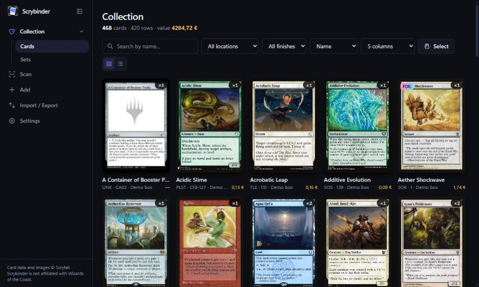
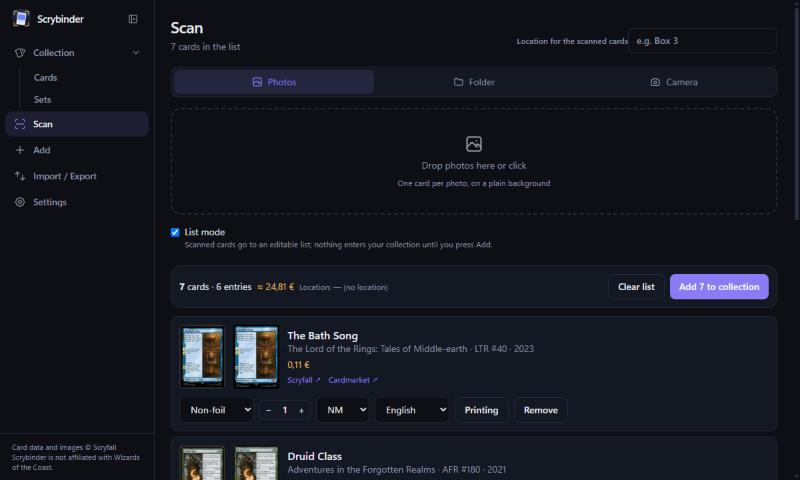
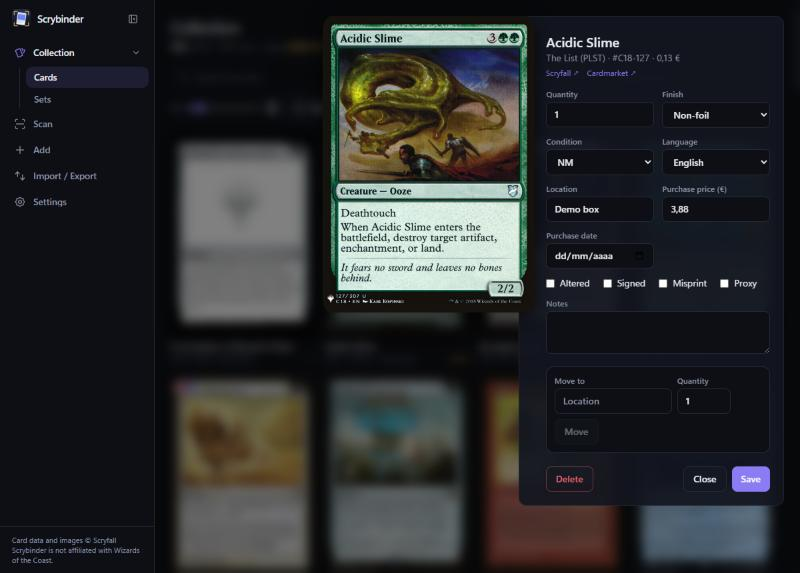
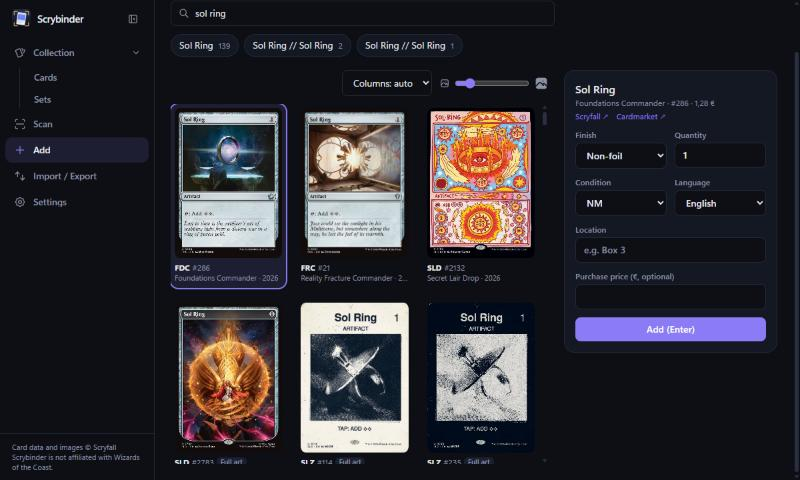
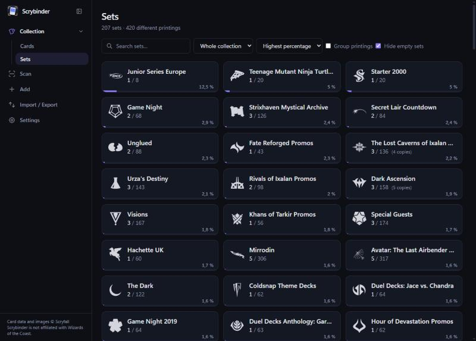

# Scrybinder

**Scan, identify and catalogue your Magic: The Gathering collection — locally, for free.**

Scrybinder is a desktop app that recognises the *exact printing* of each card you show to a camera (or drop in as a photo — even a whole binder page at once), lets you review the results in an editable list, and keeps your collection in a local database. It imports and exports ManaBox, Moxfield and Cardmarket CSVs, uses Scryfall for card data and shows Cardmarket prices in EUR. No account, no subscription, no cloud: your collection never leaves your computer.

[](https://github.com/nuno-f-rocha-alb/scrybinder/actions/workflows/ci.yml)
[](LICENSE)
[](https://github.com/nuno-f-rocha-alb/scrybinder/releases)



<table>
  <tr>
    <td width="50%"><br><sub><b>Scan list</b> — scanned cards wait in an editable list; nothing touches your collection until you press Add.</sub></td>
    <td width="50%"><br><sub><b>Card editor</b> — quantity, finish, condition, language, location, purchase data, notes.</sub></td>
  </tr>
  <tr>
    <td width="50%"><br><sub><b>Add by name</b> — pick the exact printing from every printing Scryfall knows.</sub></td>
    <td width="50%"><br><sub><b>Sets</b> — how much of each set you own.</sub></td>
  </tr>
</table>

## Contents

[Features](#features) · [Download and install](#download-and-install) · [First steps](#first-steps) · [Using Scrybinder](#using-scrybinder) · [The visual index](#the-visual-index) · [GPU acceleration](#gpu-acceleration) · [Accuracy and limitations](#accuracy-and-limitations) · [Troubleshooting](#troubleshooting) · [Security and privacy](#security-and-privacy) · [Build from source](#build-from-source) · [Contributing](#contributing)

## Features

- **Exact-printing recognition.** Card name and set/number are read with OCR; the artwork and frame are matched against a local index of Scryfall images with a DINOv2 vision model. Promo stamps, The List cards, foils, borderless and showcase frames, and non-English cards are handled — see [How it works](docs/HOW-IT-WORKS.md).
- **Photos, folders, live camera — or a whole binder page.** Drop photos, watch a folder that another program saves into, or point a webcam / capture card at your cards. Turn on *Binder page (3×3)* and one photo of a binder page adds up to nine cards at once.
- **Review before you commit.** Every scan lands in a list where you can change the printing, finish, quantity, condition and language. Uncertain reads are flagged. Hover any card image (your photo or the printing it was matched to) to see it enlarged, which settles "is this the promo or the regular one?". Prices and a running total are shown.
- **A real collection manager.** Search, filter, group by set, edit in bulk, move cards between boxes, track purchase price and date, see per-set completion. Deleted rows are saved to a trash file first.
- **Decks tied to your collection.** Build Commander and 60-card decks from cards you own and cards you do not, in folders. The deck page checks legality and shows statistics, says which copy of your collection is in which deck and what is left to buy, and imports and exports Moxfield / Archidekt / MTGO text lists — [how](#decks).
- **Import / export.** ManaBox (lossless round trip), Moxfield (collection CSV, both ways) and Cardmarket stock lists; deck lists as text.
- **Private by design.** Everything is stored in a local SQLite database. The only network traffic is to Scryfall (card data, prices and images) — [details](#security-and-privacy).
- **Runs on the CPU, faster on an NVIDIA GPU.** The installed app ships the CPU build of PyTorch; one click in Settings adds GPU support — [how](#gpu-acceleration).
- **Small updates.** Each release also publishes an *update package* of a few tens of MB instead of the ~1 GB installer — [how](#updating).

## How it compares

| | Scrybinder | ManaBox / Delver Lens | [LoreFetch](https://github.com/jnapoli87/LoreFetch) |
|---|---|---|---|
| Runs on | Windows (Linux/macOS from source) | Phone | Windows |
| Account / subscription | none | free tiers | none |
| Data stays on your PC | yes | no (cloud sync) | yes |
| Exact printing (promos, foils, serialized) | yes, with a review list | scanning picks a printing | yes |
| Import / export | ManaBox, Moxfield, Cardmarket, deck lists | own formats | CSV |
| Open source | MIT | no | GPL-3.0 |

Scrybinder does not do price history, playtesting, public deck sharing, deck combos or mobile scanning; use it alongside tools like Moxfield, Archidekt or ManaBox.

## Download and install

Get the latest build from the [Releases page](https://github.com/nuno-f-rocha-alb/scrybinder/releases). Windows 10/11 is what is tested and shipped; on Linux and macOS you [build from source](#build-from-source).

| File | What it is | Size |
|---|---|---|
| `Scrybinder-X.Y.Z-windows-setup.exe` | **Installer.** Installs for your user (no administrator needed) in `%LOCALAPPDATA%\Programs\Scrybinder`, adds a Start-menu shortcut (and an optional desktop one) and an uninstaller. Your data lives in `%LOCALAPPDATA%\Scrybinder`. | ~1.3 GB |
| `Scrybinder-X.Y.Z-windows-portable.zip` | **Portable.** Extract anywhere and run `Scrybinder.exe`. Your data stays in a `data` folder next to it, so it can live on a USB stick. | ~1.4 GB |
| `Scrybinder-X.Y.Z-update-from-A.B.C.zip` | **Update package** from the previous version (not an installer): see [Updating](#updating). | tens of MB |
| `manifest.json` | the SHA-256 of every app file (used to build update packages) | <1 MB |
| `SHA256SUMS` | checksums of the files above | tiny |

Both Windows builds are self-contained: they include Python, Tesseract (OCR), PyTorch for the CPU and the DINOv2 model, so identification works offline once the card database and the visual index are built.

**First launch warning.** The binaries are not code-signed, so Windows SmartScreen may warn the first time (*More info → Run anyway*). To check that a download is intact, compare its hash with `SHA256SUMS`:

```powershell
Get-FileHash .\Scrybinder-X.Y.Z-windows-setup.exe -Algorithm SHA256
```

If your system has no native web view, Scrybinder opens in your browser instead.

### Updating

**In the app:** *Settings → Updates → Check for updates*, then *Update now* and *Restart now*. Scrybinder downloads only the files that changed (up to three releases behind; further back it points you to the installer), checks each one against the release's checksums, and swaps them in while it runs (the few files Windows keeps locked while the app is open are put in place by a small script after you press *Restart now*). If anything fails it puts everything back, and if Scrybinder is closed or crashes in the middle of an update, the next start undoes the unfinished update. *Check on start-up* is off by default. This needs the installed (or portable) Windows app in a folder you can write to. Uninstalling afterwards may leave a few files behind in the app folder.

**By hand:** you do not have to download the whole installer again either. Each release has an update package for the version before it:

1. Close Scrybinder completely (check the system tray).
2. Download `Scrybinder-X.Y.Z-update-from-A.B.C.zip` — `A.B.C` must be the version you have now (Settings shows it).
3. Extract it **into the app folder** — `%LOCALAPPDATA%\Programs\Scrybinder` for the installer, or the folder with `Scrybinder.exe` for the portable zip — and choose to replace the files.
4. Delete the files listed in the `UPDATE.txt` inside the zip (if it lists any), and start Scrybinder.

Your collection, images and index are never touched. The package only works on top of the version it names: to jump over several versions, use the full installer — it keeps your data too.

### Linux and macOS

No ready-made build yet; they work from source and the tests run on both in CI. See [Build from source](#build-from-source). Install Tesseract yourself (`sudo apt install tesseract-ocr`, `brew install tesseract`).

## First steps

1. **Download the card database.** *Settings → Update bulk data now* fetches Scryfall's "Default Cards" file (~80 MB) once. Scrybinder refreshes it automatically at start-up when it is more than a day old, which is how prices stay current.
2. **Build the visual index (recommended).** Without it Scrybinder identifies cards from OCR only; with it, the artwork decides — including cards whose text OCR cannot read. *Settings → Visual index → Build pilot index* is enough to start ([details and timings](#the-visual-index)).
3. **Import what you have (optional).** *Import / Export* takes a ManaBox or a Moxfield CSV.
4. **Scan.** *Scan* → drop photos, watch a folder or start a camera. Check the list, set the location, press **Add to collection**.
5. **Speed it up (optional).** If you have an NVIDIA GPU, *Settings → GPU acceleration → Enable* makes the index much faster to build ([how](#gpu-acceleration)).

## Using Scrybinder

### Scanning

- **Photos** tab: drop or choose image files. **Folder** tab: watch a folder that another program saves into — only files that appear *after* you press Start are processed (what is already in the folder is ignored). **Camera** tab: a webcam or an HDMI capture card.
- One card per photo on a plain background; light from the side, not from beside the lens.
- Live cameras: a fixed overhead stand and a stable light work best. Virtual cameras that only speak Media Foundation (for example Sony *Imaging Edge Webcam*) show a black picture to OpenCV — use a UVC webcam or an HDMI capture card instead.
- The capture triggers when a card stays still for 0.3 s and re-arms when it leaves the frame. A card the camera reads again right after itself (it is still on the stand) is not counted twice: fix the quantity with − / +, or show another card.
- Photos and folders: identical cards in a row add up. `N` marks the next card as foil / a new entry (foil is not detected from the picture: press `N` before showing it). In the one-by-one confirmation mode (turn *List mode* off): `Enter` accept, `Esc` discard, `←`/`→` change printing, `F` foil, `C` condition, `L` language, `+`/`-` quantity.

### Scanning a binder page

Turn on **Binder page (3×3)** in the Scan page (it applies to the Photos and Folder tabs) and drop a photo of a whole binder page: up to 9 cards are found and each one lands in the review list as its own entry, with "N cards detected" shown after the upload.

- Shoot the page **upright** and as large as you can: photos are used up to 4500 px, and each card needs about 600 px of height to be read reliably. Keep the cards in their pockets.
- The pockets are found from their outline, and an empty pocket is told from a card by the light and dark bands of a card (title bar, art, text box), so a glossy empty pocket is not taken for one.
- Pages filled row by row (the last page of a binder) and pages with some empty pockets work, and a page holding a single card is read like a normal photo. Very strong reflections can hide a card.
- It was measured on black binders. On 10 real pages (73 cards) it found all 73 cards, counted no empty pocket, and 66 of the 73 names were right with the visual index; the rest were hard cards flagged "Please check".
- The live camera still reads one card at a time.

### Reviewing the list

Scanned cards wait in a temporary list; only **Add to collection** writes to your collection. Each entry shows your photo and the printing it was matched to — **hover either image to see it enlarged**, and open **Printing** to compare the other candidates (hover those too) when the read is flagged "Check the printing" or "Please check". Change finish, quantity, condition and language per entry. Identical entries add up.

### Importing and exporting

| Format | Import | Export |
|---|---|---|
| **ManaBox** CSV | yes — lossless round trip (the Scryfall id is kept) | yes |
| **Moxfield** collection CSV | yes — it carries no Scryfall id, so each row is matched by **edition and collector number** (rows that cannot be matched are listed, not dropped silently) | yes (the location goes into `Tags`) |
| **Cardmarket** stock list | — | yes (condition and language mappings are approximate) |

Importing the same file twice adds the cards twice. Deck lists are plain text and have their own import and export on the deck page (see [Decks](#decks)).

### Decks

The **Decks** page holds your decks, optionally in folders (one level; deleting a folder keeps its decks). A deck is its own list: it can hold cards you do not own, and what is missing is counted so you know what to buy.

- **Building.** Create a deck (optionally from a pasted list), then search for cards to add: by name, with filters for rules text, type, colours, mana value and *only cards I own*. *Only legal* hides cards that are banned in the deck's format or outside the commander's colour identity. Each card sits in the **main deck, sideboard, commander** or **maybeboard** (the maybeboard never counts).
- **Formats.** Commander, Standard, Pioneer, Modern, Legacy, Vintage and Pauper have full deck rules; *Casual* has none. The legality panel (click the status in the bottom bar) lists what is wrong: banned or not legal cards, copy limits (with the exceptions for basic lands and cards like *Relentless Rats*), 60-card size and sideboard, and for Commander the 100 cards, singleton, who may be a commander and which pairs are allowed (Partner, Partner with, Friends forever, Background, Doctor's companion), colour identity and the number of game changers. Legality comes from the Scryfall data; Brawl, Oathbreaker, brackets and companions are not checked.
- **Your copies.** Click the status of a card to reserve **copies of your collection** for it. The status says whether a card is *assigned* (every copy is in this deck), *available* (you own free copies you can assign), *in other decks* (your copies are reserved elsewhere, and which) or *missing* (what you would have to buy, with its cost). A card tagged **proxy** is in the deck but is not a real copy: it never counts as missing and never enters your collection. Lowering or deleting a collection row that is assigned to a deck is refused, naming the decks (free the copies in the deck first); *Assign free copies* in the deck header reserves every free copy a deck still needs.
- **Views.** List, Compact, Grid, Stacks (with *Every copy*) and Spoiler, grouped by type, colour, mana value, tag or collection status and sorted by name, mana value or price. The big card on the left follows the pointer and stays on the last card.
- **Statistics.** Mana curve, symbols against land sources per colour (with a warning when a colour has too few sources), types and tags, average mana value, price and cost to complete, and the chance of having enough lands or coloured sources by a given turn. Click a bar to see those cards.
- **Lists.** *Import list* and *Export list* use the common text format, `4 Lightning Bolt` or `1 Sol Ring (C21) 263 #ramp`, with `Commander`, `Deck`, `Sideboard` and `Maybeboard` sections; lines that match no card are listed. The first time, the card rules are filled from the card database you already downloaded (no new download).

## The visual index

The visual index is a local file of vectors (one for the whole card and some for its artwork) computed from Scryfall's card images with a DINOv2 vision model. It is what lets Scrybinder tell printings apart.

*Settings → Visual index*:

- **Build pilot index** — your collection, all reprints of those cards and a few thousand other printings (about 5,000–8,000 faces depending on your collection; 7,634 for the author's).
- **Build full index…** — every printing: ~112,000 images, ~12 GB of disk. It shows an estimate first and asks you to confirm.
- It can be **stopped and resumed**, and running it again only adds new printings (new sets).
- While it runs, Settings shows the counter and what is going on: *downloading images* (limited by Scryfall to 10 images per second) or *computing vectors* (the DINOv2 model).

How long it takes depends on where the model runs. The images always come from Scryfall at 10 per second, which is the floor:

| | One block of 2,048 faces | Pilot (~7,600 faces) | Full (~112,000 faces) |
|---|---|---|---|
| **CPU** (a 6-thread desktop CPU) | ~3.4 min download + ~13 min vectors | ~1 hour | ~15 hours |
| **NVIDIA GPU** | ~3.4 min: the download is the limit | ~13 minutes | ~3 hours |

The CPU figures were measured (0.38 s per face for the vectors on a 6-thread desktop CPU; yours will differ). The GPU figures are the download floor — the vectors are fast there — and a real data point agrees: on an RTX 5070 Ti, 2,064 faces took 5–6 minutes, almost all of it waiting for Scryfall.

Without the index, or without PyTorch, Scrybinder falls back to OCR-only identification. From source, or for scripting, the same job is available on the command line:

```bash
uv sync --extra vision
uv run scrybinder-index --pilot
uv run scrybinder-index --all
```

## GPU acceleration

The installed Windows app runs the visual model on the **CPU** (that is the PyTorch it ships). If you have an NVIDIA GPU, it can use it instead. In the installed app:

1. *Settings → GPU acceleration* shows your GPU and a button **Enable GPU acceleration (about 2 GB download)**. The section only offers it when it finds an NVIDIA GPU whose driver supports CUDA 12.8 or newer.
2. Scrybinder downloads the CUDA build of PyTorch (version 2.14.1 for CUDA 13 drivers, 2.11.0 for CUDA 12.8–12.9) from `download.pytorch.org` into your data folder (`gpu/`), checks it against a checksum written in the program, unpacks it, and **tests it on your GPU** before keeping it. If anything fails, it deletes the download and the app stays as it was.
3. Restart Scrybinder. Settings then says **In use** and shows the GPU as the device the visual model runs on.
4. **Remove GPU support** deletes it (the removal completes when you restart). If a driver update ever breaks it, start Scrybinder with the environment variable `SCRYBINDER_NO_GPU=1` and it ignores the GPU build.

If you run from source instead: `uv sync --extra vision-cuda`.

## Accuracy and limitations

Measured on our own test photos (see [How it works](docs/HOW-IT-WORKS.md#evaluation)): about 95 % of printings were right on a mixed set of 44 real photos after tuning on them, and 86 % (printing) / 97 % (illustration) / 96 % (top-5) on 300 synthetic photos with the full index. Most errors are the *same card printed identically* — The List vs the original, prerelease vs promo-pack stamps — where the image genuinely does not tell them apart; those are flagged for review.

### Speed and how sure the reading is

Measured on 300 synthetic photos (the same set as above, full index), reading each rectified card the way the live camera does. Test PC: AMD Ryzen 5 5600, RTX 5070 Ti (GPU on). Synthetic photos have noise, blur and glare, so they are slower to read than a clean card; use the times as a guide.

| | OCR + visual model | OCR only (no visual index) |
|---|---|---|
| Time per card, median | 0.97 s | 0.89 s |
| Time per card, mean / slowest 10 % | 1.9 s / 3.9 s | 1.8 s / 3.6 s |
| Right printing (top-1) | 85 % | 32 % |
| Right illustration | 98 % | 48 % |
| Right printing within the top 5 | 97 % | 53 % |

How much to trust a read — the confidence the app shows on each entry, with the share of reads it covers and how often the first suggestion was the right printing:

| Confidence | Share of reads | Right printing |
|---|---|---|
| High (OCR + visual model) | 61 % | 98 % |
| Medium | 20 % | 83 % |
| Low | 19 % | 47 % |

Check the Medium and Low entries before adding them; with High, the first suggestion was right in 98 out of 100 reads. Without the visual index (OCR only) 24 % of the reads find no card at all and only 18 % reach High, so build the index (Settings). The capture itself adds about 0.3 s (the card must be still) and the first card after opening Scan waits while the model loads (about 30 s on the test PC).

Known limits: Room/split cards (the artwork box does not exist), very strong holographic foils, serialized cards (identical art — you confirm), cards photographed through glare or sleeves, very dark borderless cards, sets newer than your card database or index, and non-Latin scripts for OCR (artwork still works). A live camera needs good light. Always glance at the list before adding.

## Troubleshooting

| Problem | What to do |
|---|---|
| **Building the visual index looks stuck** (the counter stays at 2000 or so) | On a CPU, computing the vectors of one block of 2,048 faces takes about 13 minutes (after its download). Newer versions show "computing vectors…" and the percentage. Try **Build pilot index** instead of the full one, or enable the GPU. Stop works and the work is kept in blocks. |
| Windows says the app is from an unknown publisher | The builds are not code-signed. *More info → Run anyway*; compare the file's hash with `SHA256SUMS`. |
| The app closes or misbehaves | It writes `app.log` (errors and what the camera did) and `crash.log` (the stack when the process dies from a native crash) in the data folder ([where](docs/DATA.md)). Attach them when you report a problem. If the camera does not detect a card, press *Save a debug frame* (Scan → Camera) with the card in place: the whole frame and the outline the app found go to `debug/` in the data folder. |
| Scan reads names but never uses the artwork | The visual index is not built (or PyTorch is missing in a source build). *Settings → Visual index*. |
| **GPU acceleration** is not offered | It needs the installed Windows app, an NVIDIA GPU and a driver with CUDA 12.8 or newer. From source use `uv sync --extra vision-cuda`. |
| Settings says PyTorch **fell back to the CPU** | The GPU build is installed but CUDA did not start (often a driver problem). Update the NVIDIA driver, or press *Remove GPU support*, or start with `SCRYBINDER_NO_GPU=1`. |
| The folder watcher ignores my existing photos | By design it only processes files that appear after you press Start. Use the Photos tab for existing files. |
| A binder page gives the wrong number of cards | Shoot it upright, closer, without a strong reflection; a card with almost no detail can be missed. The list shows what was found, and you can add the rest by hand. |
| Camera shows a black picture | Virtual cameras that only speak Media Foundation (Sony Imaging Edge Webcam) do not work with OpenCV: use a UVC webcam or an HDMI capture card. |
| Tesseract not found (source builds) | Install it and put it on your `PATH`, or set `SCRYBINDER_TESSERACT` to the executable. |
| I want to start over | Close the app and delete the data folder (or just `index/` and `images/`, which can be rebuilt). Back up `scrybinder.db` first if you want to keep your collection. |

## Security and privacy

- **Your data stays on your computer.** Everything is stored in one folder: `data/` when run from source, `%LOCALAPPDATA%\Scrybinder` (Windows), `~/Library/Application Support/Scrybinder` (macOS) or `~/.local/share/scrybinder` (Linux) for installed builds, `data` next to the executable for the portable zip, or wherever `SCRYBINDER_DATA` points. It holds the SQLite database, cached card images and the vector index. Back it up by copying the folder with the app closed. See [docs/DATA.md](docs/DATA.md).
- **The only network connections:**

  | Host | When | What |
  |---|---|---|
  | `api.scryfall.com`, `cards.scryfall.io` | card database update, images | card data, prices, images, set icons |
  | `api.github.com`, `github.com` | only when you check for updates (or *Check on start-up* is on) | the list of releases and the update package, checksum verified |
  | `download.pytorch.org` | only if you press *Enable GPU acceleration* | the CUDA build of PyTorch (checksum verified) |
  | `huggingface.co` | only in source builds, once | the DINOv2 weights (the installed app ships them) |

- **No telemetry, no analytics, no accounts.** The code contains no tracking and no secrets.
- **The local server** listens on `127.0.0.1` only, protected by a per-session token, a `SameSite=Strict` cookie and a `Host` check. Links the app opens in your browser are limited to Scryfall and Cardmarket.
- **No arbitrary code execution:** the app does not use `eval`/`exec`, `os.system` or shell commands. The subprocesses are the app itself (started with `--gpu-selftest` to test a downloaded PyTorch when you enable the GPU, and again to restart after an update) and, only when an update has locked files to put in place, a `cmd.exe` running a short script the app writes to its data folder (`update/finish.cmd`) that moves those files and starts the app.
- **Deleting files:** the app deletes only the scan captures it created, its own `gpu/` folder if you press Remove GPU support, and the old copies of the files an update replaced.
- **Verifying a download:** release files are built by GitHub Actions from the public source, and `SHA256SUMS` lets you check them. The Windows binaries are not code-signed, and the in-app updater trusts the checksums published with the release (it catches a corrupt download, not a compromised release).
- Found a vulnerability? See [SECURITY.md](SECURITY.md).

## Build from source

### What you need

| | What for | How to get it |
|---|---|---|
| **Python 3.12** | the app | [uv](https://docs.astral.sh/uv/) installs it for you |
| **[uv](https://docs.astral.sh/uv/)** | installs Python and every Python dependency | `winget install astral-sh.uv` (Windows), `brew install uv` (macOS), or see its docs |
| **Tesseract OCR** (English data) | reads the card names | `winget install UB-Mannheim.TesseractOCR` (Windows), `sudo apt install tesseract-ocr` (Linux), `brew install tesseract` (macOS). It must be on your `PATH`, or set `SCRYBINDER_TESSERACT` to its executable |
| **Node.js 20+** | only to build the UI (`ui/dist`) | [nodejs.org](https://nodejs.org) |
| **PyTorch + DINOv2** (optional) | identifies the exact printing from the artwork | the `vision` extra below |

There is no `requirements.txt`: the Python dependencies are declared in [`pyproject.toml`](pyproject.toml) and pinned in `uv.lock`, and `uv sync` installs exactly those. The extras:

| Command | Installs | Size | Result |
|---|---|---|---|
| `uv sync` | the app only | small | OCR only: it recognises the card, you pick the printing |
| `uv sync --extra vision` | + PyTorch CPU, DINOv2 | ~1 GB | identifies the printing from the artwork (needs the visual index) |
| `uv sync --extra vision-cuda` | + PyTorch for NVIDIA (CUDA 12.8; Windows/Linux) | ~3 GB | the same, much faster to build the index |

`vision` and `vision-cuda` exclude each other, and a plain `uv sync` removes PyTorch again. The DINOv2 model (~330 MB) downloads from Hugging Face the first time it is used. The full visual index needs about 12 GB of disk for the card images.

```bash
git clone https://github.com/nuno-f-rocha-alb/scrybinder.git && cd scrybinder
uv sync --extra vision          # or no extra for OCR-only; --extra vision-cuda for an NVIDIA GPU
cd ui && npm ci && npm run build && cd ..
uv run scrybinder               # desktop window; add --browser or --serve for a browser tab
uv run pytest                   # tests
```

On first run open **Settings**, update the card database and build the visual index. Packaging (PyInstaller, Windows installer) and how a release is made are described in [docs/BUILDING.md](docs/BUILDING.md).

## Contributing

Issues and pull requests are welcome — see [CONTRIBUTING.md](CONTRIBUTING.md). Bug reports with a photo that was misidentified are especially useful (card, what you expected, what you got). Everyone taking part is expected to follow the [Code of Conduct](CODE_OF_CONDUCT.md). If something in the app is hard to use, see the [accessibility statement](ACCESSIBILITY.md).

## Legal

Scrybinder is an unofficial fan project, free of charge, and is not produced, endorsed, supported or affiliated with Wizards of the Coast. *Magic: The Gathering* and its card names, images and symbols are property of Wizards of the Coast LLC. Card data, prices and images are provided by [Scryfall](https://scryfall.com); this project is not affiliated with Scryfall. Cardmarket prices come from Scryfall's data and are indicative. See [NOTICE.md](NOTICE.md) for third-party software and data credits.

Source code: [MIT License](LICENSE).
